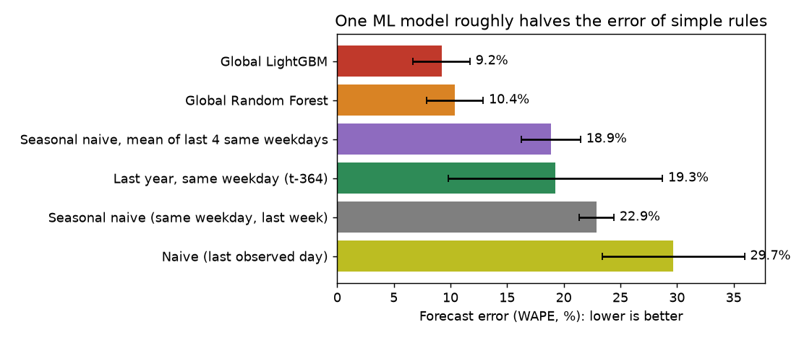
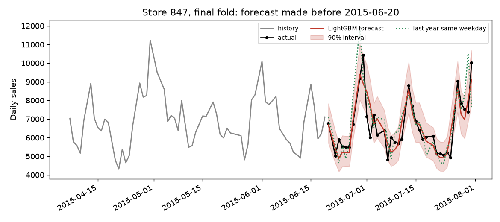
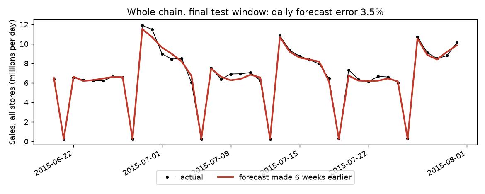

# Rossmann store sales forecasting: honest 6-week-ahead evaluation

## What this is for

Rossmann runs over a thousand drugstores. A store manager or planner needs to know roughly how
much each store will sell on each day over the next six weeks, to schedule staff and order stock.
This project builds that forecast for all 1,115 stores in the public Kaggle Rossmann data and
measures, with a test that mimics real use, how wrong it is.

"Error" below is measured in sales per store per day (the unit of the Kaggle `Sales` column) and
as WAPE, the total absolute error divided by total sales. A WAPE of 8% means the forecast for a
typical store-day is off by about 8% of that day's sales. Everything is scored on days the store
was actually open, and the model never sees sales from the period it is predicting.

## Results

<!-- RESULTS:START -->
_Generated by code from `reports/results.json` (commit `d2a30a4`)._

For every open store, forecast daily sales 42 days ahead. Across 3 rolling-origin test windows covering 1,115 stores, a store's typical day has about 7,335 in sales, and the global LightGBM forecast is off by about 689 per store per day on average (9.2% of sales, WAPE). The strongest naive baseline (seasonal naive, mean of last 4 same weekdays) is off by 18.9%, so the model cuts the error by 51% relative to it. The 90% prediction intervals contained the actual sales 86.4% of the time overall.

| Model | WAPE | RMSE | MAE | RMSPE |
|---|---|---|---|---|
| Naive (last observed day) | 29.7% +/- 6.3 | 2,791 +/- 656 | 2,174 +/- 478 | 0.483 +/- 0.112 |
| Seasonal naive, mean of last 4 same weekdays | 18.9% +/- 2.6 | 1,868 +/- 462 | 1,400 +/- 350 | 0.264 +/- 0.046 |
| Last year, same weekday (t-364) | 19.3% +/- 9.5 | 1,986 +/- 701 | 1,392 +/- 605 | 0.285 +/- 0.109 |
| Global Random Forest | 10.4% +/- 2.5 | 1,178 +/- 426 | 775 +/- 276 | 0.152 +/- 0.038 |
| **Global LightGBM** | 9.2% +/- 2.5 | 1,020 +/- 327 | 689 +/- 267 | 0.129 +/- 0.031 |

On a 100-store random sample, per-store Prophet scores WAPE 17.9% (no regressors) and 12.5% (with promo and holiday flags) against 9.4% for the global LightGBM on the same store-days.

90% intervals: 86.4% empirical coverage overall (per fold: 93.6%, 76.7%, 88.0%).

Full tables, error spread across stores, promo estimates and SHAP: [docs/RESULTS.md](docs/RESULTS.md).
<!-- RESULTS:END -->

### The results in three pictures

**1. A single machine-learning model roughly halves the error of simple rules.** Each bar is the
average forecast error (WAPE) over three test windows; the whiskers show how much it varies.



**2. What a forecast looks like for one store.** Grey is the sales history the forecast was made
from, black is what actually happened, red is the forecast made six weeks ahead, and the shaded
band is the 90% prediction interval.



**3. Add all stores together and the forecast is closer still.** Individual stores are noisy, but
the whole-chain total follows the real sales closely, which is what stock and staffing plans at
head-office level depend on.




## Notebooks

Each notebook does one job, runs real code on the data, and shows its charts inline (outputs are
already rendered, so GitHub displays them without running anything). Run them in order:

| Notebook | What it does |
|---|---|
| [`00_Results_Overview`](notebooks/00_Results_Overview.ipynb) | Headline results from the saved pipeline run: model comparison, real store forecasts with intervals, whole-chain replay, error by store, interval hit rates, promo and SHAP summary. Needs no Kaggle data. |
| [`01_EDA_FeatureEngineering`](notebooks/01_EDA_FeatureEngineering.ipynb) | Explores the data (trends, weekly and yearly rhythm, promos, store types, data gaps), builds the leak-safe features, and proves no future sales leak in. |
| [`02_Baselines_Prophet_SARIMAX`](notebooks/02_Baselines_Prophet_SARIMAX.ipynb) | The three forecast windows, naive baselines on every store, and per-store Prophet and SARIMAX models. |
| [`03_ML_Models_LightGBM_RF_XGBoost`](notebooks/03_ML_Models_LightGBM_RF_XGBoost.ipynb) | Trains the global LightGBM, Random Forest and XGBoost models, compares them, and shows where the error comes from and what the models use. |
| [`04_Prediction_Intervals`](notebooks/04_Prediction_Intervals.ipynb) | Builds 90% conformal prediction intervals step by step and measures how often they hold, including the window where they fall short. |
| [`05_Promo_Analysis`](notebooks/05_Promo_Analysis.ipynb) | Estimates the promo lift three ways (raw, fixed-effects regression with a randomisation check, model what-if), labelled as associations. |
| [`06_Explainability_SHAP_PDP`](notebooks/06_Explainability_SHAP_PDP.ipynb) | Opens the model with SHAP and partial dependence plots. |
| [`07_Error_Analysis_and_Ablation`](notebooks/07_Error_Analysis_and_Ablation.ipynb) | Where the forecast fails (store segments, reopened stores, holidays), how much planning weekly or chain-wide helps, which feature groups matter (ablation), and how much fresher data helps. |

To run them locally: `pip install jupyterlab`, then `jupyter lab notebooks`. Notebooks 01 to 07
read `data/train.csv` and `data/store.csv` and take from a few seconds to about four minutes each.

### New findings from notebook 07

* **Reopened stores are the weak spot.** Store-days within 14 days of reopening after a closure of
  two weeks or more are 1.3% of rows but have 16.4% error against 9.2% for the rest.
* **Planning at a coarser level is much more reliable.** Error is 9.3% for one store-day, 5.7% for one store-week and 2.8% for the whole chain by week.
* **The planned promo calendar matters most.** Removing it costs 1.5 points of error, more than any other single feature group.
* **Sales history and store identity cover for each other.** Dropping either alone costs under 1 point; dropping both together takes error from 7.9% to 27.4%.
* **A 6-week-ahead forecast is almost as good as a 1-week-ahead one** (7.9% against 7.7%), so refreshing more often buys little.

## What it improves

* **Forecast quality:** the global model's error is roughly half that of the best naive baseline
  and clearly below per-store Prophet, with one model covering every store instead of one fit per
  store.
* **Trustworthy measurement:** accuracy is judged on three rolling windows with no future data
  leaking in, so the numbers reflect what a planner would actually experience.
* **Honest uncertainty:** every forecast comes with a 90% interval, and its real coverage is
  measured rather than assumed.
* **Actionable insight:** the promo effect and the SHAP drivers show what moves sales.

## How the evaluation works

* **Task:** from sales observed up to a forecast origin, predict every open store's daily sales for
  the next 42 days (the Kaggle horizon). The promo calendar, holidays and open/closed flags for
  the target days are treated as known in advance, as they were in the competition.
* **Rolling-origin cross-validation, 3 folds, expanding window.** Each fold trains on everything
  before its origin and predicts the next 42 days. Origins (2014-08-01, 2014-12-01, 2015-06-20)
  were fixed before running any model and cover the Kaggle test season, the Christmas peak and the
  latest data. Results are reported per fold and as mean +/- standard deviation over folds.
* **No future leakage by construction.** Every sales-derived feature is lagged by at least the
  horizon, sales on or after the origin are hidden before features are built, and tests
  scramble the forecast window's sales and assert no forecast changes
  (`tests/test_features.py`, `tests/test_fold_leakage.py`).
* **Baselines that must be beaten:** last observed value, same weekday last week, mean of the last
  four same weekdays, and same weekday one year earlier.
* **Models:** one global LightGBM over all stores (store id and store history as features), a
  global Random Forest, and per-store Prophet (with and without promo and holiday regressors)
  on a fixed random sample of stores, because one Prophet fit per store per fold does not scale
  to every store here. On that sample every model is scored on the same store-days.
* **Prediction intervals:** split conformal on the log scale, calibrated on the window just before
  each origin, with empirical coverage reported per fold rather than assumed.
* **Promotion effect:** reported as an association (model counterfactual and a fixed-effects
  regression with a placebo check), not as a validated causal estimate. See `docs/RESULTS.md`.
* **Explainability:** SHAP on the final-fold LightGBM.

## Reproduce

The pipeline reads the two Kaggle files `data/train.csv` and `data/store.csv` (the Rossmann Store
Sales competition data). They are in the repository; if you need to fetch them again,
`rossmann check-data` prints the Kaggle steps.

```bash
python -m venv .venv && source .venv/bin/activate      # Windows: .venv\Scripts\activate
pip install -r requirements.txt -r requirements-dev.txt && pip install -e . --no-deps
rossmann check-data          # prints the Kaggle steps if train.csv / store.csv are missing
rossmann run-all             # a few minutes on a 16-core laptop; rewrites the results below
pytest                       # core tests use synthetic data; notebook runs need the Kaggle files
```

`rossmann run-all` writes `reports/results.json`, `reports/figures/*.png`, `docs/RESULTS.md` and
the results block above, all written by code. `rossmann report` rebuilds the figures and tables from
the last run without retraining. `make run`, `make test` and `make lint` are shortcuts if you have
`make`. The pins were produced and tested on Python 3.13.5
(`pyproject.toml` allows 3.11 to 3.13 but only 3.13 was run; 3.14 is excluded).

## Repository layout

```
notebooks/               one notebook per step, with charts (start with 00_Results_Overview)
src/rossmann_forecast/   installable package: data, features, splits, baselines, models,
                         conformal, promo, explain, evaluation, report, cli
tests/                   pytest: metrics, splits, no-look-ahead features, fold leakage, conformal
docs/RESULTS.md          generated results (all tables)
reports/                 results.json and figures written by the pipeline
```

## Limitations

* One retail chain, one three-year period (2013-01-01 to 2015-07-31). Three folds is a small
  number, so the standard deviation across folds is itself a rough estimate.
* Promo calendars, holidays and open/closed flags for the forecast window are assumed known.
  If the real promo plan changes after the forecast is made, accuracy will be worse than reported.
* Hyperparameters were fixed up front, not tuned, and no separate hold-out beyond the three folds
  was kept. Fold origins were chosen once and not changed after seeing results.
* Prophet and its promo variant run on a random sample of stores, not all of them; the table says
  which numbers cover which stores.
* Conformal intervals assume future errors look like errors in the calibration window. Seasonal
  shifts (for example the Christmas fold) break that, and the per-fold coverage table shows by how
  much.
* The promo effect is an association. Every store follows the same alternate-week promo calendar,
  so there is no same-day control group, and the estimate cannot be separated from anything else
  that alternates with the promo weeks. No experiment backs it, and the model counterfactual is
  reported as a point estimate without an interval for the same reason.
* Store-level error is uneven: a minority of stores are much harder to forecast than the average.
  The tail is shown in `docs/RESULTS.md`; the average alone hides it.
