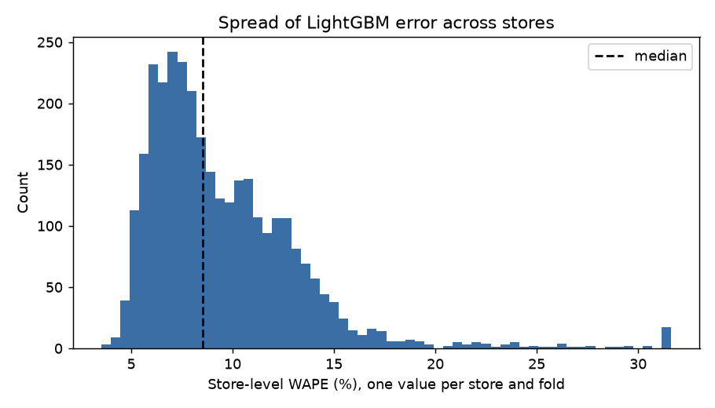
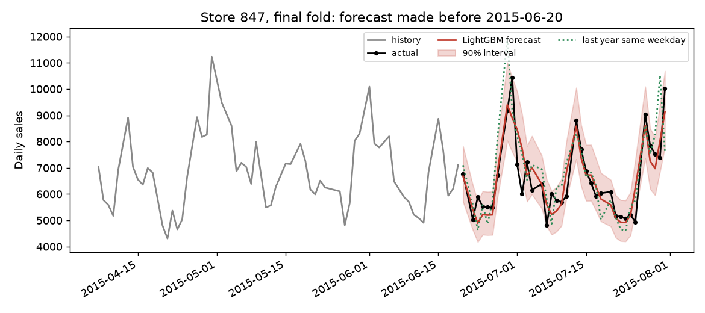
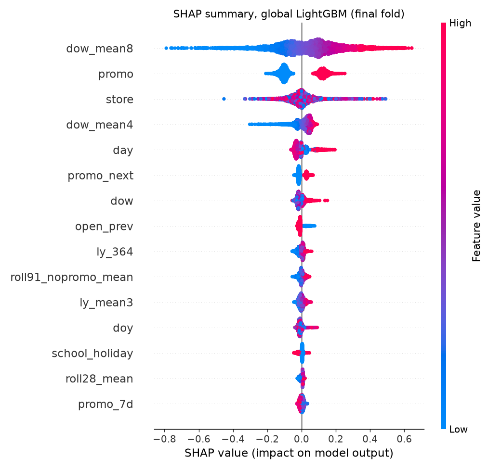

# Results

Generated by `rossmann run-all` (see Makefile). Do not edit by hand; every number below is written by code from `reports/results.json`.

Run: commit `d2a30a4`, Python 3.13.5, pandas 3.0.6, LightGBM 4.7.0, seed 42. Total runtime 4.0 minutes on the machine that produced these numbers.

## In plain English

This project predicts how much each Rossmann store will sell on each day for the next 6 weeks, so managers can plan staff and stock. It was tested on 3 separate 6-week periods that the model had never seen: for each period it learned only from sales before it began. On a typical store-day the forecast is off by 9.2% of sales, compared with 18.9% for the best simple rule (the average of the same weekday over the last four weeks), a 51% reduction in error.

## Evaluation design

* Task: forecast daily sales of every open store for the next 42 days, using only sales observed before the forecast origin. Promo calendar, holidays and open/closed flags for the target dates are treated as known in advance.
* Data: 1,115 stores, 2013-01-01 to 2015-07-31. Rows with the store closed or zero sales are not scored (as in the Kaggle metric).
* Rolling origin, expanding window: each fold fits on everything before its origin and predicts the next window. Sales-derived features are lagged by at least the horizon.
* Mean +/- standard deviation (n-1) are over folds; each fold metric is computed over all scored store-days in that fold.

| Fold | Forecast from | Forecast to | Scored store-days | Stores | Mean daily sales |
|---|---|---|---|---|---|
| 1 | 2014-08-01 | 2014-09-11 | 33,708 | 934 | 6,790 |
| 2 | 2014-12-01 | 2015-01-11 | 32,163 | 1,115 | 8,237 |
| 3 | 2015-06-20 | 2015-07-31 | 40,282 | 1,115 | 6,979 |

## All stores: point forecasts

The headline measure is the average error as a percent of sales (WAPE: total absolute error divided by total sales). The other three columns are standard alternatives: MAE is the average miss in sales units per store per day; RMSE is similar but punishes big misses more; RMSPE is the Kaggle competition measure, a percentage version of RMSE. Lower is better for all of them.

| Model | Average error (WAPE, % of sales) | RMSE | MAE | RMSPE |
|---|---|---|---|---|
| Copy the last open day | 29.7% +/- 6.3 | 2,791 +/- 656 | 2,174 +/- 478 | 0.483 +/- 0.112 |
| Same weekday last week | 22.9% +/- 1.5 | 2,247 +/- 193 | 1,681 +/- 212 | 0.370 +/- 0.022 |
| Average of the same weekday over the last 4 weeks | 18.9% +/- 2.6 | 1,868 +/- 462 | 1,400 +/- 350 | 0.264 +/- 0.046 |
| Same weekday last year | 19.3% +/- 9.5 | 1,986 +/- 701 | 1,392 +/- 605 | 0.285 +/- 0.109 |
| Random Forest | 10.4% +/- 2.5 | 1,178 +/- 426 | 775 +/- 276 | 0.152 +/- 0.038 |
| **LightGBM (our model)** | 9.2% +/- 2.5 | 1,020 +/- 327 | 689 +/- 267 | 0.129 +/- 0.031 |

Per fold (WAPE % / RMSE):

| Model | Fold 1 (2014-08-01) | Fold 2 (2014-12-01) | Fold 3 (2015-06-20) |
|---|---|---|---|
| Copy the last open day | 35.8 / 2,990 | 30.0 / 3,325 | 23.3 / 2,059 |
| Same weekday last week | 24.3 / 2,198 | 23.1 / 2,459 | 21.3 / 2,084 |
| Average of the same weekday over the last 4 weeks | 16.6 / 1,514 | 21.7 / 2,391 | 18.3 / 1,698 |
| Same weekday last year | 29.9 / 2,624 | 16.0 / 2,100 | 11.9 / 1,235 |
| Random Forest | 9.0 / 935 | 13.3 / 1,669 | 8.9 / 928 |
| LightGBM (our model) | 7.6 / 834 | 12.1 / 1,398 | 7.9 / 828 |

## Per-store Prophet versus the global model (100-store random sample)

Prophet is fitted separately per store and per fold, so it is run on a fixed random sample of 100 stores (seed 42), not all 1,115. All rows below are scored on exactly the same store-days.

| Model | Average error (WAPE, % of sales) | RMSE | MAE | RMSPE |
|---|---|---|---|---|
| Copy the last open day | 29.8% +/- 6.4 | 2,896 +/- 744 | 2,251 +/- 536 | 0.489 +/- 0.103 |
| Same weekday last week | 23.1% +/- 1.8 | 2,337 +/- 277 | 1,740 +/- 260 | 0.378 +/- 0.025 |
| Average of the same weekday over the last 4 weeks | 19.3% +/- 3.1 | 1,990 +/- 550 | 1,475 +/- 407 | 0.271 +/- 0.056 |
| Same weekday last year | 19.5% +/- 8.8 | 2,052 +/- 694 | 1,447 +/- 582 | 0.290 +/- 0.094 |
| Random Forest | 10.8% +/- 3.1 | 1,324 +/- 514 | 832 +/- 336 | 0.167 +/- 0.053 |
| **LightGBM (our model)** | 9.4% +/- 2.3 | 1,124 +/- 293 | 724 +/- 267 | 0.139 +/- 0.033 |
| Prophet, one model per store | 17.9% +/- 1.5 | 1,818 +/- 337 | 1,359 +/- 264 | 0.279 +/- 0.084 |
| Prophet per store, also told promos and holidays | 12.5% +/- 1.9 | 1,383 +/- 317 | 949 +/- 253 | 0.205 +/- 0.077 |

## How error is spread across stores

Store-level WAPE for each of the 3,164 (store, fold) pairs. A good average can hide bad stores, so the tail is shown.

| Model | p10 | median | p90 | p99 | max |
|---|---|---|---|---|---|
| LightGBM (our model) | 5.8% | 8.5% | 13.8% | 25.6% | 53.2% |
| Same weekday last year | 9.5% | 16.0% | 34.5% | 48.3% | 78.9% |
| Average of the same weekday over the last 4 weeks | 13.6% | 18.7% | 24.6% | 31.3% | 60.1% |

Share of (store, fold) pairs where LightGBM has lower WAPE than: same weekday last year 91%; average of the same weekday over the last 4 weeks 93%.

Five worst stores by mean WAPE: store 192 (30% WAPE, mean sales 13,759), store 909 (30% WAPE, mean sales 13,918), store 820 (26% WAPE, mean sales 12,407), store 306 (24% WAPE, mean sales 4,607), store 1056 (23% WAPE, mean sales 4,891).

## Prediction intervals (split conformal, log scale)

Intervals are the LightGBM forecast +/- a conformal quantile of absolute log errors. Calibration residuals come from a model refitted one horizon earlier and scored on the window just before each forecast origin, so no calibration row overlaps a test window.

| Nominal | Fold | Empirical coverage | Mean width (sales units) | Median width / forecast |
|---|---|---|---|---|
| 80% | 1 | 86.9% | 1,916 | 29% |
| 80% | 2 | 63.1% | 2,218 | 26% |
| 80% | 3 | 77.1% | 1,651 | 24% |
| 80% | all | 76.0% |  |  |
| 90% | 1 | 93.6% | 2,510 | 38% |
| 90% | 2 | 76.7% | 2,974 | 35% |
| 90% | 3 | 88.0% | 2,195 | 32% |
| 90% | all | 86.4% |  |  |

90% interval coverage by forecast day: days 1-14 90.8%; days 15-28 82.7%; days 29-42 85.4%. Per (store, fold) coverage quantiles p10 / p50 / p90: 70% / 89% / 100%; 73% of store-folds are within 10 points of nominal.

## Promotion effect (association, not a validated causal estimate)

Promos are scheduled by the retailer, not randomised, and in this data the whole chain follows one promo calendar (alternate Monday-to-Friday weeks): every store has the same promo flag on a given date. So there is no same-day control group, a date fixed effect absorbs the promo entirely, and the effect is identified only from week-to-week alternation. It cannot be separated from anything else that alternates with the promo weeks. Read both estimates below as associations, not proven causal effects.

| Estimate | Lift on promo days | 95% interval | Extra sales per promo day | Calendar weeks |
|---|---|---|---|---|
| Model counterfactual, fold 1 | +29.0% | none (see note) | 1,770 | 4 |
| Model counterfactual, fold 2 | +30.6% | none (see note) | 2,406 | 3 |
| Model counterfactual, fold 3 | +27.2% | none (see note) | 1,806 | 3 |
| Fixed effects: store x weekday, year-month, holiday controls; all data | +39.2% | +36.6% to +41.9% |  | 135 |

Raw ratio of mean sales (promo days / other open days) minus 1: +38.8%. The model counterfactual flips only the promo flag of the fitted global model on the promoted days of each forecast window, leaving neighbouring-day promo features unchanged, so it is not an independent check on the regression and can differ from it; it has no interval because a window holds only a few independent promo weeks and every store shares them, so a bootstrap over stores would overstate precision. The fixed-effects interval uses standard errors clustered by calendar week, the level at which the promo varies.

Randomisation check: permuting whole promo weeks among the weeks of the same month 100 times gave a spread (standard deviation) of the log-effect of 0.0318, largest absolute value 0.0851, against the real estimate of +0.3309; randomisation p-value 0.010. This checks the estimate is not what shuffled promo weeks would produce; it does not rule out a confounder that alternates with the promo.

Assumptions: within a month, which weeks are promo weeks is unrelated to other demand drivers; no store-specific timing; no stockpiling or post-promo dip is modelled (the estimate is the average difference between promo and non-promo days, not a net effect over time); customer counts are not controlled for because they are a consequence of the promo.

## Feature attribution (SHAP, final fold model)

Mean absolute SHAP value on 5,000 sampled forecast rows, in log1p(sales) units. This explains the model's predictions, not causes in the world.

| Feature | Mean abs SHAP |
|---|---|
| dow_mean8 | 0.1582 |
| promo | 0.1145 |
| store | 0.0509 |
| dow_mean4 | 0.0383 |
| day | 0.0310 |
| promo_next | 0.0213 |
| dow | 0.0187 |
| open_prev | 0.0157 |
| ly_364 | 0.0120 |
| roll91_nopromo_mean | 0.0116 |
| ly_mean3 | 0.0114 |
| doy | 0.0109 |

## Training cost

| Fold | LightGBM, all stores (s) | Random Forest, all stores (s) | Prophet plain, per store (s) | Prophet + regressors, per store (s) |
|---|---|---|---|---|
| Fold 1 | 13 | 17 | 0.67 | 0.53 |
| Fold 2 | 14 | 26 | 0.44 | 0.48 |
| Fold 3 | 18 | 33 | 0.44 | 0.45 |

One LightGBM fit covers every store; Prophet needs one fit per store, so its cost scales with the number of stores. Seconds are wall-clock on the machine that ran the pipeline.
